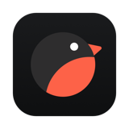
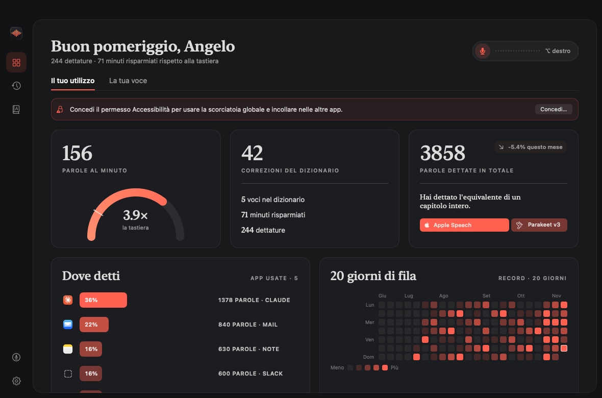

<p align="center">
  
</p>

<h1 align="center">Dillo</h1>

<p align="center">
  <strong>Parla, e il testo appare dove stai scrivendo.</strong><br>
  Dettatura push-to-talk per macOS, veloce e privata: tutto avviene sul tuo Mac.
</p>

<p align="center">
  macOS 26+ · Apple Silicon · Swift 6 · SwiftUI · v1.0.0
</p>

---



## Cos'è Dillo

Dillo trasforma la voce in testo in **qualsiasi app**: tieni premuta una scorciatoia (di default **⌥ destro**), parla, rilascia. Il testo, già punteggiato, viene incollato dove si trova il cursore, che sia Mail, Slack, Note, il terminale o una chat con un'AI.

Il riconoscimento vocale gira **interamente sul Mac**, sul Neural Engine di Apple Silicon. L'audio non viene mai inviato a nessun server né salvato su disco.

## Funzionalità

- **Push-to-talk ovunque**: scorciatoia globale configurabile (⌥, ⌘, ⌃ destro, Fn), in modalità *tieni premuto* o *premi per avviare/fermare*. **Esc** annulla la dettatura in corso.
- **Due motori di trascrizione on-device**
  - **Apple Speech** (predefinito): il riconoscimento nativo di macOS 26, in streaming. Il testo è pronto pochi istanti dopo il rilascio, e il modello lo gestisce macOS.
  - **Parakeet v3** (NVIDIA, tramite FluidAudio): 25 lingue europee, molto preciso. Si scarica una sola volta (~470 MB).
- **Anteprima dal vivo**: un indicatore flottante con il pettirosso di Dillo mostra la voce e le parole mentre le pronunci, con una dissolvenza morbida parola per parola.
- **Dizionario personale**: nomi, sigle e termini tecnici. Le parole vengono suggerite al riconoscimento e le varianti sbagliate (es. "cloud code") sono corrette automaticamente ("Claude Code").
- **Cronologia** ricercabile, raggruppata per giorno, con app di destinazione, durata e correzioni. Ogni voce si copia con un clic. Si esporta in Markdown o CSV.
- **Panoramica**: parole al minuto (confrontate con la tastiera), parole dettate, correzioni, app più usate, giorni consecutivi di utilizzo e calendario dell'attività.
- **Scelta del microfono**, inclusi dispositivi virtuali (Krisp, BlackHole…).
- **Avviso di microfono muto** se all'inizio della dettatura non arriva audio.
- **Rilevamento della lingua**: se detti in un'altra lingua, Dillo propone di cambiarla.
- **Barra dei menu** con il pettirosso animato: a riposo è una sagoma, mentre detti escono onde corallo dal becco, mentre trascrive le onde pulsano.
- **Guida introduttiva** al primo avvio: permessi spiegati passo per passo e una dettatura di prova.

| Cronologia | Dizionario | Benvenuto |
|---|---|---|
|  |  |  |

## Requisiti

- macOS **26 Tahoe** o successivo
- Mac con **Apple Silicon** (M1 o successivo)
- Per compilare: **Xcode 26+** e [XcodeGen](https://github.com/yonaskolb/XcodeGen) (`brew install xcodegen`)

## Installazione

1. Apri `Dillo-x.y.z.dmg` e trascina **Dillo** nella cartella **Applicazioni**.
2. Avvia Dillo: si apre la guida introduttiva.
3. Concedi i due permessi richiesti:
   - **Microfono**, per ascoltare la voce;
   - **Accessibilità**, per la scorciatoia globale e per incollare il testo nelle altre app (Impostazioni di Sistema → Privacy e sicurezza → Accessibilità).
4. Fai la dettatura di prova. Fatto.

## Uso

| Azione | Come |
|---|---|
| Dettare in qualsiasi app | Tieni premuto **⌥ destro**, parla, rilascia |
| Annullare la dettatura | **Esc** mentre registri |
| Registrare dalla finestra di Dillo | Pulsante microfono oppure **⌘R** (il testo va nella cronologia) |
| Cercare nella cronologia | **⌘F** |
| Impostazioni | **⌘,** |
| Riaprire la guida | Menu **Aiuto → Guida introduttiva a Dillo** |

La scorciatoia, la modalità e il microfono si cambiano in **Impostazioni**.

### Impostazioni

- **Generale**: microfono, incolla automatico, indicatore flottante, suoni, apertura al login, stato dei permessi.
- **Scorciatoia**: tasto e modalità (tieni premuto / premi per avviare e fermare).
- **Modello**: Apple Speech o Parakeet v3, lingua, stato del download.
- **Dati**: periodo di conservazione della cronologia, esportazione, eliminazione della cronologia e del modello Parakeet.

## Privacy

- **Nessun audio lascia il Mac.** Entrambi i motori lavorano in locale, e l'audio vive solo in memoria per la durata della dettatura.
- **Nessun account, nessuna telemetria, nessun tracciamento.**
- Le uniche connessioni di rete sono **i download dei modelli**: Apple Speech tramite macOS, Parakeet da Hugging Face al primo utilizzo.
- Cronologia e dizionario sono salvati solo in `~/Library/Application Support/Dillo/` e si possono esportare o eliminare dalle Impostazioni.

## Risoluzione dei problemi

| Problema | Soluzione |
|---|---|
| La scorciatoia non fa nulla | Controlla che Dillo sia attivo in Privacy e sicurezza → **Accessibilità**. Se hai aggiornato l'app e non funziona più, rimuovi la voce con **–** e aggiungila di nuovo. |
| Il testo resta negli appunti ma non viene incollato | Stesso caso: manca il permesso Accessibilità. Il menu di Dillo lo segnala. |
| «Il microfono non sente nulla» | Scegli il microfono giusto in Impostazioni → Generale → Microfono e controlla il livello d'ingresso in Impostazioni di Sistema → Suono. |
| Errore durante il download di Parakeet | Di solito è un problema di rete temporaneo: Dillo riprova da solo 3 volte, poi usa **Riprova** in Impostazioni → Modello. |
| Testo nella lingua sbagliata | Imposta la lingua in Impostazioni → Modello, oppure accetta la proposta "Stai parlando…?". |
| Riavviare da zero | Esci da Dillo ed elimina `~/Library/Application Support/Dillo/` (cronologia e dizionario). |

---

## Sviluppo

### Compilare ed eseguire

```bash
brew install xcodegen
xcodegen generate          # crea Dillo.xcodeproj da project.yml
open Dillo.xcodeproj       # oppure:
xcodebuild -project Dillo.xcodeproj -scheme Dillo -configuration Debug -derivedDataPath build build
open build/Build/Products/Debug/Dillo.app
```

Il progetto Xcode è **generato**: le modifiche a target, impostazioni e Info.plist vanno fatte in [`project.yml`](project.yml), non in Xcode.

Per la firma serve un certificato del team impostato in `DEVELOPMENT_TEAM`. Una firma stabile è importante, perché macOS lega il permesso Accessibilità alla firma dell'app.

### Test

```bash
xcodebuild test -project Dillo.xcodeproj -scheme Dillo -derivedDataPath build
```

I test (Swift Testing, cartella [`DilloTests/`](DilloTests)) coprono la logica pura: correzioni del dizionario, allineamento dell'anteprima live, statistiche e serie di giorni, parser dei tracciati SVG, rilevamento della lingua, esportazione CSV. Durante i test l'app non avvia scorciatoie, microfono né modelli.

### Architettura

```
Dillo/
├── App/            Punto d'ingresso, finestre e comandi, pannello "Informazioni", snapshot di debug
├── Core/           DictationController (stati e flusso), modelli SwiftData, preferenze,
│                   dizionario, statistiche, esportazione
├── Engines/        Protocollo SpeechEngine + AppleSpeechEngine e ParakeetEngine
├── Services/       Microfono (AVAudioEngine/CoreAudio), scorciatoia globale, incolla,
│                   permessi, rilevamento lingua
└── UI/             Finestra principale (barra a icone + pagine), indicatore flottante,
                    barra dei menu, impostazioni, guida, tema e marchio
```

**Flusso di una dettatura**

```
Scorciatoia (HotkeyMonitor)
  → DictationController.start
  → AudioRecorder (AVAudioEngine, microfono scelto)
  → SpeechEngine.append(buffer)           ← anteprima live → HUD / finestra
rilascio
  → SpeechEngine.finish()  → testo
  → VocabularyProcessor (dizionario)
  → SwiftData (cronologia) + TextInserter (appunti + ⌘V, poi ripristino degli appunti)
```

- **`SpeechEngine`** è il punto di estensione. Un motore riceve i buffer del microfono mentre parli e restituisce il testo finale al rilascio. Per aggiungerne uno basta un nuovo tipo conforme e un caso in `EngineKind`.
- **Apple Speech** usa `SpeechAnalyzer` + `SpeechTranscriber` in streaming, con risultati provvisori e il dizionario passato come `contextualStrings`.
- **Parakeet** accumula l'audio a 16 kHz, aggiorna l'anteprima sugli ultimi 12 secondi e al rilascio trascrive tutto (≈ 100× il tempo reale su M4).
- **Persistenza**: SwiftData in `~/Library/Application Support/Dillo/Dillo.store`. Se il database è danneggiato, viene spostato da parte (non cancellato) e l'app riparte con un database nuovo.
- **Niente sandbox**: incollare nelle altre app richiede di inviare eventi da tastiera, cosa che la sandbox del Mac App Store non permette. Per questo Dillo si distribuisce con **Developer ID** e notarizzazione, non sul Mac App Store.

### Snapshot dell'interfaccia (solo Debug)

```bash
build/Build/Products/Debug/Dillo.app/Contents/MacOS/Dillo -demo -snapshot /tmp/dillo-snap
```

Avvia Dillo con un database di esempio in memoria e salva un PNG di ogni pagina, della guida e delle icone della barra dei menu, poi esce. Le immagini in `docs/screenshots` sono generate così.

### Marchio

- Icona dell'app: `Branding/AppIcon-1024.png` (sorgente `Branding/AppIcon.svg`, Affinity). Per rigenerare tutte le dimensioni: `zsh Branding/make_icon.sh`.
- Mascotte: `Branding/Robin.svg` (viewBox 640×512, livelli `beak`, `body`, `breast`, `eye`, `wave1`–`wave3`). I tracciati sono copiati in [`RobinMark.swift`](Dillo/UI/RobinMark.swift) e disegnati in vettoriale: se aggiorni l'SVG, ricopia gli attributi `d`.
- Palette: corallo `#FD6248` / `#FF6B5A`, grafite `#111214` / `#2E2D2E`, crema `#F4F1EA`. I token sono in [`Theme.swift`](Dillo/UI/Theme.swift). Titoli e numeri usano il serif di sistema (New York).

## Rilascio

```bash
# Build di prova (firmata con il certificato di sviluppo, non distribuibile)
scripts/release.sh

# Build distribuibile: firmata Developer ID e notarizzata da Apple
DEVELOPER_ID="Developer ID Application: Nome Cognome (TEAMID)" \
NOTARY_PROFILE="dillo-notary" \
scripts/release.sh
```

Lo script [`scripts/release.sh`](scripts/release.sh):
1. rigenera il progetto ed esegue i test;
2. crea l'archivio Release;
3. firma con Developer ID (con hardened runtime e timestamp);
4. notarizza l'app con `notarytool` e applica lo staple;
5. crea `dist/Dillo-x.y.z.dmg` con il collegamento ad Applicazioni;
6. firma, notarizza e applica lo staple anche al DMG;
7. scrive lo SHA-256.

**Una tantum, prima del primo rilascio**
1. Iscriviti all'[Apple Developer Program](https://developer.apple.com/programs/) e crea un certificato **Developer ID Application**.
2. Salva le credenziali per la notarizzazione:
   ```bash
   xcrun notarytool store-credentials dillo-notary --apple-id <email> --team-id <TEAMID>
   ```

**Per ogni versione**: aggiorna `MARKETING_VERSION` e `CURRENT_PROJECT_VERSION` in [`project.yml`](project.yml), annota le novità in [`CHANGELOG.md`](CHANGELOG.md), poi lancia lo script.

## Crediti

- Riconoscimento vocale **Apple Speech** (framework Speech di macOS).
- **Parakeet TDT 0.6B v3** © NVIDIA, licenza CC-BY-4.0.
- **FluidAudio** © FluidInference, licenza Apache 2.0.

Dettagli in [`THIRD_PARTY_NOTICES.md`](THIRD_PARTY_NOTICES.md). Gli stessi crediti sono nel pannello *Informazioni su Dillo*.

## Licenza

© 2026 Angelo Sferra. Tutti i diritti riservati.
