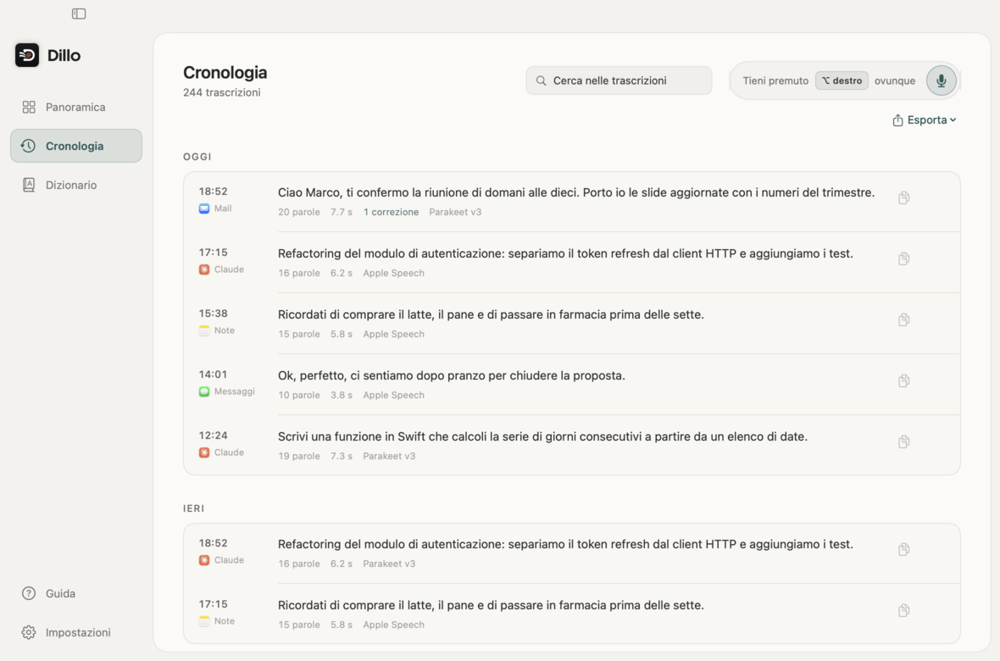
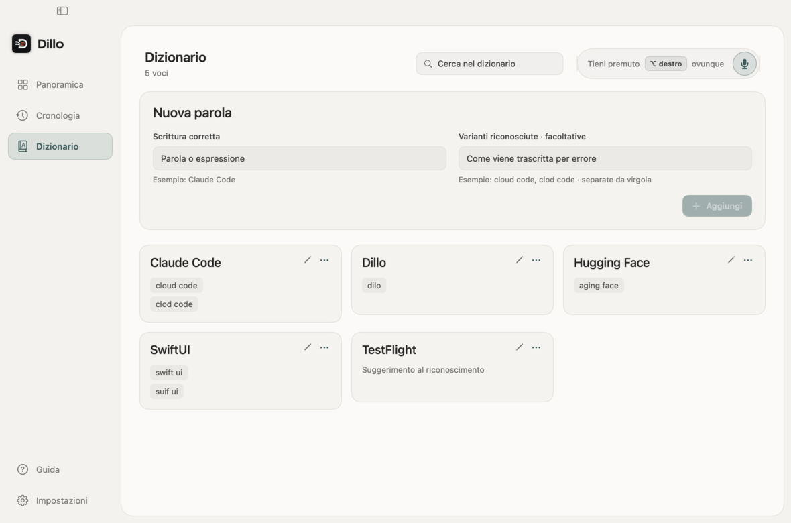
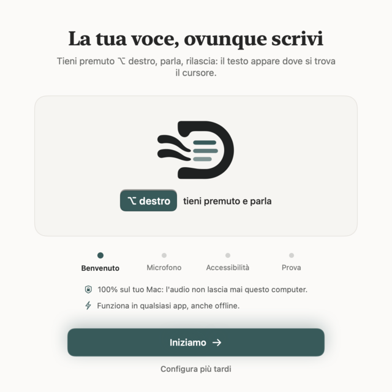
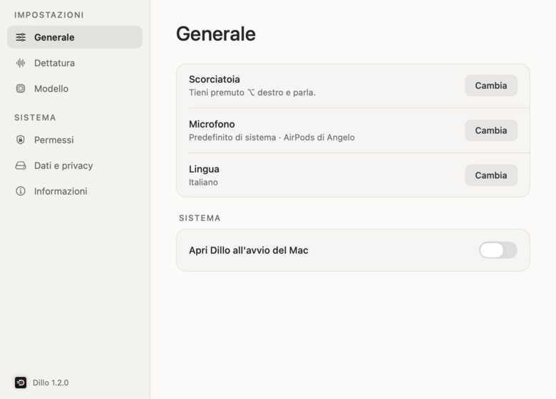
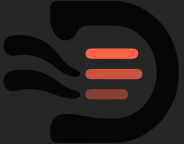

<p align="center">
  
</p>

<h1 align="center">Dillo</h1>

<p align="center">
  <strong>Parla, e il testo appare dove stai scrivendo.</strong><br>
  Dettatura push-to-talk per macOS, veloce, elegante e privata: tutto avviene sul tuo Mac.
</p>

<p align="center">
  <a href="https://github.com/Sferralove/dillo/actions/workflows/ci.yml"></a>
  <a href="LICENSE"></a>
  
  
  
</p>

<p align="center">
  <a href="https://github.com/Sferralove/dillo/releases/latest"><strong>Scarica l'ultima versione</strong></a> ·
  <a href="#funzionalità">Funzionalità</a> ·
  <a href="#compilare-dal-codice">Compilare</a> ·
  <a href="CONTRIBUTING.md">Contribuire</a>
</p>

---


> [!NOTE]
> **Un progetto personale, in evoluzione.** Dillo nasce come progetto personale ed è stato sviluppato in
> *vibecoding*, cioè scritto in gran parte insieme a strumenti di intelligenza artificiale. È open source e
> funziona, ma è ancora un **work in progress**: può contenere imperfezioni, bug o parti non complete al 100%.
> Segnalazioni e contributi sono benvenuti: aiutano a farlo crescere.

> **In English** — Dillo is a personal project built largely through *vibe coding* (AI-assisted development).
> It works, but it's still a work in progress and may be imperfect or incomplete. Feedback and contributions are welcome.
>
> Dillo is an open-source, push-to-talk dictation app for macOS. Hold a key, speak, release:
> your words are typed into whatever app you're using. Speech recognition runs **entirely on-device**
> (Apple Speech or NVIDIA Parakeet on the Neural Engine) — no audio ever leaves your Mac.
> The interface is in Italian today; contributions, translations and issues in English are welcome.

## Indice

- [Perché Dillo](#perché-dillo)
- [Funzionalità](#funzionalità)
- [Requisiti](#requisiti)
- [Installazione](#installazione)
- [Uso](#uso)
- [Privacy](#privacy)
- [Domande frequenti](#domande-frequenti)
- [Risoluzione dei problemi](#risoluzione-dei-problemi)
- [Compilare dal codice](#compilare-dal-codice)
- [Architettura](#architettura)
- [Rilascio](#rilascio)
- [Roadmap](#roadmap)
- [Contribuire](#contribuire)
- [Crediti e licenza](#crediti-e-licenza)

## Perché Dillo

Parlare è circa **tre volte più veloce** che scrivere a tastiera. Dillo rende la voce un modo naturale di scrivere su Mac:

- **Ovunque**: funziona in qualsiasi app, dalla mail al terminale alle chat con un'AI, senza copia-incolla.
- **Istantaneo**: con il motore nativo di Apple il testo è pronto pochi istanti dopo il rilascio del tasto.
- **Privato per progetto**: niente cloud, niente account, niente telemetria. L'audio esiste solo in memoria, il tempo della dettatura.
- **Tuo**: un dizionario personale per nomi e termini tecnici, e una cronologia ricercabile ed esportabile.
- **Libero**: codice aperto con licenza MIT.

*Dillo* in italiano significa "dillo, pronuncialo". Il logo è una «D» attraversata dalle scie della voce, che diventano righe di testo.

## Funzionalità

### Dettatura
- **Push-to-talk ovunque**: scorciatoia globale configurabile (⌥ destro, ⌥ sinistro, ⌘ destro, ⌃ destro, Fn), in modalità *tieni premuto* o *premi per avviare e fermare*.
- **Incolla automatico** nel punto in cui si trova il cursore, poi gli appunti tornano come prima.
- **Esc** annulla la dettatura in corso.
- **Anteprima dal vivo**: un indicatore flottante con il logo mostra la voce e le parole mentre le pronunci, con una dissolvenza morbida parola per parola.

### Due motori on-device
| | **Apple Speech** (predefinito) | **Parakeet v3** |
|---|---|---|
| Origine | Riconoscimento nativo di macOS 26 (`SpeechAnalyzer`) | NVIDIA Parakeet TDT 0.6B v3 via [FluidAudio](https://github.com/FluidInference/FluidAudio) |
| Funzionamento | Streaming: testo pronto quasi subito | Trascrizione rapidissima (~100× il tempo reale su M4) |
| Lingue | Lingua impostata (italiano, inglese, spagnolo, francese, tedesco, portoghese) | 25 lingue europee |
| Download | Gestito da macOS | ~470 MB, una sola volta |

### Dizionario personale
Nomi, sigle, marchi e termini tecnici. Le parole vengono **suggerite al riconoscimento** (Apple Speech) e le **varianti sbagliate sono corrette** automaticamente: "cloud code" diventa "Claude Code".

### Cronologia e Panoramica
- **Cronologia** ricercabile, raggruppata per giorno, con app di destinazione, durata e correzioni. Ogni voce si copia con un clic. Si esporta in **Markdown** o **CSV**.
- **Panoramica**: parole al minuto (confrontate con la tastiera), parole dettate, correzioni, app più usate, giorni consecutivi di utilizzo e calendario dell'attività.

### Rifiniture
- Scelta del **microfono**, inclusi i dispositivi virtuali (Krisp, BlackHole…).
- **Avviso di microfono muto** se all'inizio della dettatura non arriva audio.
- **Rilevamento della lingua**: se detti in un'altra lingua, Dillo propone di cambiarla.
- **Logo animato nella barra dei menu**: a riposo è una sagoma, mentre detti le righe di testo diventano corallo e seguono la voce, mentre trascrive pulsano.
- **Guida introduttiva** al primo avvio, con i permessi spiegati e una dettatura di prova.
- **Controllo dei dati**: conservazione della cronologia, esportazione ed eliminazione.

| Cronologia | Dizionario |
|---|---|
|  |  |

| Benvenuto | Impostazioni |
|---|---|
|  |  |

## Requisiti

- macOS **26 Tahoe** o successivo
- Mac con **Apple Silicon** (M1 o successivo)

## Installazione

1. Scarica `Dillo-x.y.z.dmg` dalla pagina [Releases](https://github.com/Sferralove/dillo/releases/latest).
2. Apri il DMG e trascina **Dillo** nella cartella **Applicazioni**.
3. Avvia Dillo: la guida introduttiva ti accompagna nei due permessi necessari.
   - **Microfono**, per ascoltare la voce.
   - **Accessibilità**, per la scorciatoia globale e per incollare il testo nelle altre app (Impostazioni di Sistema → Privacy e sicurezza → Accessibilità).
4. Fai la dettatura di prova: sei pronto.

Preferisci compilarla tu? Vedi [Compilare dal codice](#compilare-dal-codice).

## Uso

| Azione | Come |
|---|---|
| Dettare in qualsiasi app | Tieni premuto **⌥ destro**, parla, rilascia |
| Annullare la dettatura | **Esc** mentre registri |
| Registrare dalla finestra di Dillo | Pulsante microfono oppure **⌘R** (il testo va nella cronologia) |
| Cercare nella cronologia o nel dizionario | **⌘F** |
| Impostazioni | **⌘,** |
| Riaprire la guida | Menu **Aiuto → Guida introduttiva a Dillo** |

### Impostazioni
- **Generale**: microfono, incolla automatico, indicatore flottante, suoni, apertura al login, stato dei permessi.
- **Scorciatoia**: tasto e modalità.
- **Modello**: Apple Speech o Parakeet v3, lingua, stato del download.
- **Dati**: conservazione della cronologia, esportazione, eliminazione della cronologia e del modello Parakeet.

<p align="center">
  <br>
  <sub>Il logo nella barra dei menu durante una dettatura.</sub>
</p>

## Privacy

- **Nessun audio lascia il Mac.** Entrambi i motori lavorano in locale, e l'audio vive solo in memoria per la durata della dettatura.
- **Nessun account, nessuna telemetria, nessun tracciamento.**
- **Rete usata solo per i modelli**: Apple Speech tramite macOS, Parakeet da Hugging Face al primo utilizzo.
- **Dati solo in locale**: cronologia e dizionario stanno in `~/Library/Application Support/Dillo/`, da cui puoi esportarli o eliminarli in qualsiasi momento.
- **Codice aperto**: puoi verificare tutto quanto sopra leggendo il codice.

Dettagli sul modello di sicurezza in [SECURITY.md](SECURITY.md).

## Domande frequenti

**Funziona senza internet?**
Sì. Dopo il primo download del modello della lingua (Apple Speech) o di Parakeet, Dillo funziona completamente offline.

**Quale motore devo usare?**
Apple Speech è il più reattivo e non occupa spazio nell'app: è la scelta consigliata. Prova Parakeet se detti spesso in più lingue o se ti serve più precisione su termini difficili.

**Perché non è sul Mac App Store?**
Per incollare il testo nelle altre app, Dillo deve inviare eventi da tastiera, cosa che la sandbox del Mac App Store non permette. Le versioni ufficiali sono firmate con Developer ID e notarizzate da Apple.

**Posso usarlo in inglese o in un'altra lingua?**
Sì, la lingua di dettatura si sceglie in Impostazioni → Modello. Per ora l'interfaccia è solo in italiano: [le traduzioni sono benvenute](CONTRIBUTING.md).

**Dillo salva la mia voce?**
No. L'audio non viene mai scritto su disco. Viene salvato solo il testo trascritto, nella cronologia locale, e puoi impostarne la conservazione o eliminarlo.

## Risoluzione dei problemi

| Problema | Soluzione |
|---|---|
| La scorciatoia non fa nulla | Controlla che Dillo sia attivo in Privacy e sicurezza → **Accessibilità**. Dopo un aggiornamento, se non funziona più, rimuovi la voce con **–** e aggiungila di nuovo. |
| Il testo resta negli appunti ma non viene incollato | Stesso caso: manca il permesso Accessibilità. Dillo lo segnala nella finestra e nel menu. |
| «Il microfono non sente nulla» | Scegli il microfono giusto in Impostazioni → Generale e controlla il livello d'ingresso in Impostazioni di Sistema → Suono. |
| Errore durante il download di Parakeet | Di solito è un problema di rete temporaneo: Dillo riprova da solo, poi usa **Riprova** in Impostazioni → Modello. |
| Testo nella lingua sbagliata | Imposta la lingua in Impostazioni → Modello, oppure accetta la proposta «Stai parlando…?». |
| Ripartire da zero | Esci da Dillo ed elimina `~/Library/Application Support/Dillo/`. |

Non hai trovato la risposta? [Apri una issue](https://github.com/Sferralove/dillo/issues/new/choose).

---

## Compilare dal codice

Requisiti: **Xcode 26+** e [XcodeGen](https://github.com/yonaskolb/XcodeGen).

```bash
brew install xcodegen
git clone https://github.com/Sferralove/dillo.git
cd dillo

# Firma con il tuo account Apple (basta un account gratuito)
cp Config/Signing.local.xcconfig.example Config/Signing.local.xcconfig
# → imposta il tuo DEVELOPMENT_TEAM nel file

xcodegen generate
open Dillo.xcodeproj        # poi ⌘R
```

Il progetto Xcode è **generato** da [`project.yml`](project.yml) e non è incluso nel repository: target, impostazioni e Info.plist si modificano lì.

### Test

```bash
xcodebuild test -project Dillo.xcodeproj -scheme Dillo -derivedDataPath build
```

I test ([`DilloTests/`](DilloTests), con Swift Testing) coprono la logica pura: correzioni del dizionario, allineamento dell'anteprima live, statistiche e serie di giorni, parser SVG, rilevamento della lingua, esportazione CSV. La [CI](.github/workflows/ci.yml) li esegue su ogni pull request e fallisce se la build contiene warning.

### Screenshot

```bash
build/Build/Products/Debug/Dillo.app/Contents/MacOS/Dillo -demo -snapshot /tmp/dillo-snap
```

Avvia Dillo con dati di esempio in memoria, senza dati personali, e salva un PNG di ogni pagina. Le immagini di questo README sono generate così.

## Architettura

```
Dillo/
├── App/        Punto d'ingresso, finestre e comandi, pannello Informazioni, snapshot di debug
├── Core/       DictationController (stati e flusso), modelli SwiftData, preferenze,
│               dizionario, statistiche, esportazione
├── Engines/    Protocollo SpeechEngine + AppleSpeechEngine e ParakeetEngine
├── Services/   Microfono (AVAudioEngine/CoreAudio), scorciatoia globale, incolla,
│               permessi, rilevamento lingua
└── UI/         Finestra (barra a icone + pagine), indicatore flottante, barra dei menu,
                impostazioni, guida, tema e marchio
```

**Il percorso di una dettatura**

```
Scorciatoia (HotkeyMonitor)
  → DictationController.start
  → AudioRecorder (AVAudioEngine, microfono scelto)
  → SpeechEngine.append(buffer)        → anteprima live (HUD, finestra)
rilascio del tasto
  → SpeechEngine.finish()              → testo
  → VocabularyProcessor                → dizionario applicato
  → SwiftData (cronologia) + TextInserter (appunti → ⌘V → ripristino)
```

- **`SpeechEngine`** è il punto di estensione: un motore riceve l'audio mentre parli e restituisce il testo al rilascio. Per aggiungerne uno vedi [CONTRIBUTING.md](CONTRIBUTING.md#aggiungere-un-motore-di-trascrizione).
- **Apple Speech** usa `SpeechAnalyzer` + `SpeechTranscriber` in streaming, con risultati provvisori; il dizionario arriva come `contextualStrings`.
- **Parakeet** accumula l'audio a 16 kHz, aggiorna l'anteprima sugli ultimi 12 secondi e al rilascio trascrive tutto.
- **Persistenza**: SwiftData. Se il database è danneggiato, viene messo da parte e l'app riparte con uno nuovo.
- **Interfaccia**: SwiftUI con `@Observable`, AppKit solo per pannelli, eventi globali e appunti. Il tema è in [`Theme.swift`](Dillo/UI/Theme.swift), il logo vettoriale in [`LogoMark.swift`](Dillo/UI/LogoMark.swift).

### Marchio
- Icona: `Branding/AppIcon-1024.png` (generata da `AppIcon.svg`; `AppIcon.af` è la vecchia sorgente Affinity). Per rigenerare le dimensioni: `zsh Branding/make_icon.sh`.
- Logo: `Branding/Logo Only.svg` (marchio) e `Branding/Logo Full.svg` (marchio + scritta), disegnati in vettoriale da `LogoMark.swift`.
- Palette: corallo `#FD6248`, grafite `#111214` / `#2E2D2E`, crema `#F4F1EA`. Titoli e numeri usano il serif di sistema (New York).

## Rilascio

```bash
# Build di prova (firma di sviluppo, non distribuibile)
scripts/release.sh

# Build ufficiale: firmata Developer ID e notarizzata da Apple
DEVELOPER_ID="Developer ID Application: Nome Cognome (TEAMID)" \
NOTARY_PROFILE="dillo-notary" \
scripts/release.sh
```

Lo script [`scripts/release.sh`](scripts/release.sh) esegue i test e crea l'archivio Release. Poi firma l'app con hardened runtime, la notarizza e applica lo staple. Infine crea `dist/Dillo-x.y.z.dmg`, lo firma, lo notarizza e ne scrive lo SHA-256.

**Una tantum**: serve un certificato **Developer ID Application** ([Apple Developer Program](https://developer.apple.com/programs/)) e le credenziali di notarizzazione:
```bash
xcrun notarytool store-credentials dillo-notary --apple-id <email> --team-id <TEAMID>
```

**Per ogni versione**:
1. aggiorna `MARKETING_VERSION` e `CURRENT_PROJECT_VERSION` in [`project.yml`](project.yml);
2. sposta le voci di *Non ancora rilasciato* del [CHANGELOG](CHANGELOG.md) nella nuova versione;
3. lancia lo script e pubblica il DMG in una [GitHub Release](https://github.com/Sferralove/dillo/releases/new) con il tag `vX.Y.Z`.

## Roadmap

Idee per le prossime versioni. Discutiamone nelle [issue](https://github.com/Sferralove/dillo/issues):

- [ ] Interfaccia in inglese e altre lingue
- [ ] Aggiornamenti automatici (Sparkle)
- [ ] Scorciatoie personalizzate con combinazioni di tasti
- [ ] Comandi vocali per la punteggiatura e la formattazione ("a capo", "elenco puntato")
- [ ] Riscrittura del testo con un modello linguistico locale (tono, pulizia delle esitazioni)
- [ ] Profili per app (lingua o dizionario diversi in base all'app attiva)

## Contribuire

I contributi sono benvenuti: bug, idee, traduzioni, documentazione e codice.

- Leggi la guida [CONTRIBUTING.md](CONTRIBUTING.md) per preparare l'ambiente e il flusso di lavoro.
- Rispetta il [Codice di condotta](CODE_OF_CONDUCT.md).
- Segnala le vulnerabilità in privato secondo [SECURITY.md](SECURITY.md).

## Crediti e licenza

Dillo è distribuito con licenza **MIT**: vedi [LICENSE](LICENSE). Il nome, il logo e l'icona identificano il progetto ufficiale: per i fork pubblici vedi [TRADEMARKS.md](TRADEMARKS.md).

Dillo si appoggia a:
- **Apple Speech**, il framework di riconoscimento vocale di macOS;
- **[Parakeet TDT 0.6B v3](https://huggingface.co/nvidia/parakeet-tdt-0.6b-v3)** © NVIDIA, licenza CC-BY-4.0;
- **[FluidAudio](https://github.com/FluidInference/FluidAudio)** © FluidInference, licenza Apache 2.0.

Dettagli in [THIRD_PARTY_NOTICES.md](THIRD_PARTY_NOTICES.md). Le novità di ogni versione sono nel [CHANGELOG](CHANGELOG.md).

<p align="center"><sub>Fatto con cura in Italia 🐦</sub></p>
